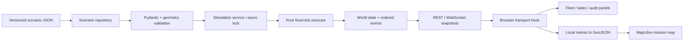

# Architecture

Only FastAPI lifespan owns the service. Commands and timer updates run on one asyncio event loop and share a lock. The engine is deterministic and independently testable. Static definitions and runtime states are distinct Pydantic types. Scenario validation catches invalid IDs, geometry, route endpoints, bounds and clearance before startup.

Frontend components follow the Phase 1 design. `Panels.tsx` groups the small cards and side panels; `MissionControl.tsx` composes the header and summary. Presentation-only selection stays in React. Map state updates preserve camera. Network disconnects never advance a local substitute simulator.

Phase 1 uses file-backed scenarios and in-memory runs. A future repository can persist snapshots and experiment records without placing database code inside the engine. Future planner/allocator/semantic interfaces must remain independent of the UI and transport. No placeholder implementations masquerade as those systems.

The requested larger UI library stack is deliberately deferred: bespoke CSS and React state suffice for this bounded screen. Tailwind/shadcn, query caches, Zustand, charts and database adapters can be introduced when their features are implemented.
